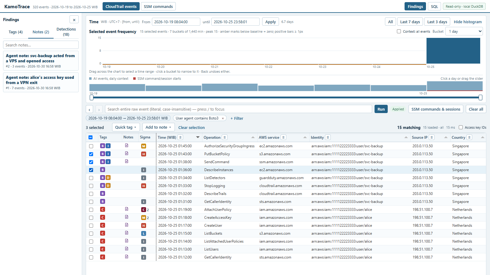

#  KamoTrace

Investigate AWS CloudTrail logs in a desktop browser. Search events, follow
related activity and record findings with tags and notes.



In this synthetic case, an AI agent uses MCP to trace a leaked access key and
follow the `svc-backup` user's activity. It tags related events and writes the
evidence-linked notes shown as **Findings**, ready for human review.
[Follow the worked investigation](docs/user-guide.md#end-to-end-example).

You can also use an AI assistant to help investigate. Connect Claude Code, Amp
or another assistant through the Model Context Protocol (MCP) to search events,
follow related activity and write findings you can review in the browser.

KamoTrace runs on your computer. It opens the evidence database read-only and
stores notes and tags in a separate file. You do not need a cloud account for
KamoTrace, a database server, Docker or a Node.js build.

## What you can do

- Search event content and filter by time, identity, IP address and other fields.
- Find unusual activity with value counts and a timeline of events.
- Record findings: shared, evidence-linked observations, separate from event tags.
- Add [Suzaku detections](docs/user-guide.md#suzaku-detections) based on Sigma rules.
- Add country, city and network information with [offline IP enrichment](docs/user-guide.md#ip-enrichment).
- Review [AWS Systems Manager (SSM) commands and output](docs/user-guide.md#ssm-command-browser-desktop).
- Let a [local AI agent](docs/user-guide.md#agent-access-mcp) search evidence and record findings.

## Get started

You need:

- Python 3.11 or later
- [uv](https://docs.astral.sh/uv/getting-started/installation/)
- a local copy of this repository
- a CloudTrail JSON export with a top-level `Records` array

The commands below use PowerShell and example Windows paths. Replace the paths
with your own. For containers, follow the [Docker instructions](docs/user-guide.md#docker).

### 1. Install KamoTrace

```powershell
uv tool install C:\path\to\KamoTrace
```

If you are working from the checkout without installing the command, use
`uv run kamotrace` instead of `kamotrace` in the steps below.

#### Full-auto: one command from AWS login to browser

After logging in with your normal AWS tooling, `kamotrace auto` runs steps 2–5
for you, in dependency order, and then opens the server:

```powershell
kamotrace auto C:\cases\example
```

It installs and verifies Suzaku and DB-IP Lite (unless already installed),
downloads CloudTrail and SSM from all enabled regions (maximum available history),
imports `case.duckdb`, adds IP enrichment and Suzaku detections, and starts the
UI on http://127.0.0.1:8765. Every default can be overridden, for example
`--profile investigation --start 2026-10-01 --end 2026-10-02`, `--source FILE`
to skip AWS, `--skip-suzaku`, or `--no-serve` for unattended use. If anything
fails or you interrupt it, **rerun the same command**: completed work is kept,
including the collection's frozen time range. See
[full-auto preparation](docs/user-guide.md#full-auto-preparation) for all
options and recovery rules.

### 2. Get your CloudTrail export

In the AWS console:

1. Open **CloudTrail → Event history**.
2. Choose your time range.
3. Choose **Download events → Download as JSON**.

A download contains management events from one region, from the last 90 days,
with up to 200,000 events. Keep it on a private local disk: events can contain
credentials and personal information.

Alternatively, use the resumable CLI downloader below to combine regions.
The importer also accepts multiple regional exports, folders of S3 trail logs,
gzip files and stdin; see [importing multiple files or a stream](#multiple-files-gzip-and-stdin).

#### Download from an existing AWS login

Log in first using your normal AWS tooling (for example, `aws sso login --profile investigation`).
KamoTrace uses boto3's existing credential chain, optionally selected with `--profile`;
it does not perform an interactive login or save credentials. All AWS calls are read-only.
The bundled SDK dependency includes CRT support for credentials created by `aws login`.

```powershell
kamotrace download --profile investigation --dest C:\cases\example\download --regions all --start 2026-10-01 --end 2026-10-02
```

- `--regions all` selects enabled regions in the current account/partition
  (requires `ec2:DescribeRegions`). Or choose explicit regions, e.g.
  `--regions ap-southeast-1 us-east-1`. Set your AWS default region for the
  partition you use; if unset, the bootstrap region is `us-east-1`.
- Both endpoints are **inclusive**. Dates mean UTC: the example includes
  October 1 and 2 in full, through `2026-10-02T23:59:59.999999Z`.
  ISO timestamps must have `Z` or an offset, e.g. `2026-10-01T08:00:00+08:00`.
  This collection convention is separate from the viewer's end-exclusive filters.
- Omit `--start` and `--end` to download the maximum available history through
  collection start time. A warning is printed even with `--progress off`: CloudTrail
  Event History retains only 90 days; SSM command/terminated session history generally
  retains 30 days, though older active sessions may be available. Expired data cannot
  be recovered, and collection can be large and slow. Either endpoint can also be
  supplied alone: omitted start means all available history (CloudTrail queries the
  90 days ending at the end time), and omitted end means collection start time.
  The default end time is saved in the checkpoint and reused on resume, not advanced.
  In the manifest, `start: null` means no requested lower bound; service retention
  limits still apply.
- Both CloudTrail and SSM are selected by default. Use `--services cloudtrail`
  or `--services ssm` to collect only one. The range selects event time,
  command request time or session start time, not sessions merely overlapping it.
- Add `--compress` to gzip generated CloudTrail, SSM and CloudWatch JSON exports.
  Output names become `cloudtrail.json.gz`, `ssm.json.gz` and `logs/*.json.gz`;
  original S3 object bytes are preserved; the manifest and checkpoint are not compressed.
  Both `import` and `serve --ssm-export` read gzip directly.
- `--progress auto` (default) fills the terminal bar with 🦆 emojis and shows UTC timestamped
  tick logs when redirected. Force `bar`, `log` (batch/headless), or `off`.
  Progress goes to stderr; the bar measures completed region/service work, not
  a guessed event total. Page/cache counts and S3 transfer ticks show activity.
  Below the bar, each busy worker has its own line.
  The CloudTrail ETA is rough. AWS gives no page totals, so each region's remaining
  pages are estimated: a running daily batch is projected from how much of its day
  the newest-first events have covered, and unstarted days use the region's median
  finished day (checkpoint replays included). Time comes from that region's own pace
  of pages fetched from AWS, never replays, and the slowest region is reported.
  The bar shows `estimating` until every unfinished region has fetched 10 pages over
  10 seconds, or while a batch is already larger than usual but under 10% through its
  day. A busy hour later in a day can still exceed the estimate. SSM has no ETA
  (`SSM ETA unknown`). When CloudTrail finishes, the ETA becomes its elapsed time.
  CloudTrail page updates include the requested UTC range: each daily batch can
  contain multiple API pages of up to 50 events, not one date range per page.
  Set `$env:KAMOTRACE_NO_EMOJI = "1"` in PowerShell, or
  `KAMOTRACE_NO_EMOJI=1` in your shell environment, for an ASCII-only bar.
  Any nonempty value disables emoji; logs always use plain text.

Rerun the **same command and destination** after interruption or renewing your
login. SQLite checkpoints commit every API page and cursor, including empty
pages. CloudTrail is split into daily batches; expired cursors restart only
their batch and duplicate event IDs are removed within each region. Regions are
collected concurrently, and within each region CloudTrail and SSM run at the same
time (their API quotas are separate), so SSM history near its 30-day limit is not
left waiting behind a long CloudTrail download. Two daily CloudTrail batches per
region run at once; they share that region's pace of at most one LookupEvents call
start every 0.55 s (AWS allows two per second per account and region, shared with
other tools using the same account). Output order does not depend on timing. The
first failure, including a missing SSM, S3, CloudWatch Logs or KMS permission, stops
all workers after their in-flight call or S3 block and is reported. SDK retries
handle transient failures/throttling. Interrupted S3 objects restart, while
completed objects are reused only when both their saved ETag and local SHA-256
match. Conflicting ETags across listings stop collection without replacing the
collected bytes; use a new destination for a fresh snapshot. Older checkpoints
without ETag bindings re-download those objects using `IfMatch` before trusting them.
Resume refuses a different
account/partition, range, regions, services, compression or log locations. Use a new destination
for a fresh snapshot: completed requests are not refreshed, including active
commands/sessions or logs delivered later. Do not run two collectors in one directory.

The destination contains `cloudtrail.json` (one importable `Records` array, with
original event JSON preserved), `ssm.json` (commands, per-system/plugin outputs,
active and historical session records), `logs/`, `manifest.json` (coverage and log
source/file mapping), and `checkpoint.sqlite`. Keep the whole directory private
and outside Git (or under ignored `data/`). Import and browse with:

```powershell
kamotrace import --source C:\cases\example\download\cloudtrail.json --database C:\cases\example\case.duckdb
kamotrace serve --database C:\cases\example\case.duckdb --ssm-export C:\cases\example\download\ssm.json
```

CloudTrail Event History provides available **management events from the last
90 days**, not data events, S3 trails or Lake. SSM Run Command and terminated
session history generally retain **30 days**. Commands include inline outputs
(which AWS may truncate) plus output from their configured S3/CloudWatch destinations.
For existing interactive session transcripts, add repeatable
`--session-s3 s3://BUCKET/PREFIX/` and/or `--session-log-group GROUP` options.
S3 objects must contain an exact selected session ID as a path component or
`SESSION-ID.log` filename; CloudWatch streams use the session ID prefix.
Only transcripts for sessions still returned by SSM are collected. Choose
prefixes/groups appropriate to the selected regions; custom layouts are not inferred.
Session transcripts are saved separately, **not displayed in the command viewer**.
Logging must already have been enabled; SSH/port-forwarding sessions have no
transcripts. Empty results do not prove no activity occurred.

Permissions depend on collection: `sts:GetCallerIdentity`, `cloudtrail:LookupEvents`,
`ssm:ListCommands`, `ssm:ListCommandInvocations`, `ssm:GetCommandInvocation`,
`ssm:DescribeSessions`, plus `s3:ListBucket`/`s3:GetObject`,
`logs:FilterLogEvents` and `kms:Decrypt` where the log destinations require them.
Permission failures stop with a nonzero status and leave resumable checkpoints;
`manifest.json` is marked complete only after all selected collection succeeds.
Missing, expired or not-yet-delivered logs cannot be recovered by this command.

#### Check trail configuration and S3 log coverage

Event History covers only 90 days. Older events, data events and complete
records live in S3 trail logs, if a trail was configured. To see what exists
before you collect or import, run this read-only check:

```powershell
kamotrace trailcheck --profile investigation --json C:\cases\example\trailcheck.json
```

The report shows each trail's Region scope, event selectors, logging and
delivery state, and its S3 bucket's restrictions: public access block, policy,
encryption, versioning and lifecycle. It also shows the year/month date
prefixes observed per account and Region in S3. Observed prefixes are not proof
of complete logs; denied checks are reported as unknown, not absent. Exit status
1 means a partial report. Details and options are in
[CloudTrail trail check](docs/user-guide.md#cloudtrail-trail-check).

### 3. Import the events

Put `event_history.json` in a case folder, then run:

```powershell
Set-Location C:\cases\example
kamotrace import --source event_history.json --database case.duckdb
```

The importer preserves the original records and JSON numeric precision. It
records the source file's SHA-256 hash and a canonical hash for each record.
It refuses to overwrite an existing database.

#### Multiple files, gzip and stdin

Combine regional files into **one new database in one invocation**, without
manually merging JSON. Mix plain JSON and gzip inputs; `--source` is repeatable
and also accepts several paths after it:

```powershell
kamotrace import --source C:\cases\example\us-east-1.json --source C:\cases\example\ap-southeast-1.json.gz --database C:\cases\example\combined.duckdb
```

For many S3 trail files, pass a **CloudTrail-only folder**. It is searched
recursively for `.json` and `.json.gz` files in sorted path order:

```powershell
kamotrace import --source C:\cases\example\trail-logs --database C:\cases\example\combined.duckdb
```

Or pipe one complete `{"Records": [...]}` document into `--source -` (POSIX shell):

```sh
gzip -dc cloudtrail.json.gz | kamotrace import --source - --database case.duckdb
```

Stdin also accepts gzip bytes directly, so decompression is optional. Use a
binary-preserving pipe; older PowerShell text pipelines may change bytes.
Concatenating several JSON documents is not a merge: pass them as separate sources.
Do not pass a whole downloader directory containing SSM/manifest/log JSON as a
CloudTrail folder; use its `cloudtrail.json` or `cloudtrail.json.gz` explicitly.

Imports never append to or replace existing evidence. To keep regions separate,
import each file into its own database; to combine them, select the entire file
set when creating a new database. All records, including duplicates across
overlapping files, are preserved with their original `awsRegion`. Each event has
`source_file` and a one-based `source_ordinal`; `import_sources` and `build_info`
retain each source's byte hash, size, record count and global record range.
Single-source identity remains that source's SHA-256 (of compressed bytes for
gzip); multi-source identity hashes the ordered source hashes, not local paths.
Changing input order changes the identity because it changes global record IDs.
Stdin is spooled to private temporary disk for hashing and independent record
verification, then deleted. Keep your original inputs for reproducibility and
Suzaku; a stdin import cannot recreate the incoming original file for you.

### 4. Add GeoIP information

Enrich source IP addresses before investigating. Country, city and network
information can help you spot unusual activity. The free DB-IP Lite databases
need no account or licence key:

```powershell
kamotrace get-dbip
```

Use the folder printed by `get-dbip` in the next command. This example uses the
October 2026 release; replace the path with your downloaded folder:

```powershell
kamotrace enrich --database case.duckdb --geolite2 "$HOME\.kamotrace\tools\dbip-lite-2026-10"
```

Lookups run offline and the original evidence stays unchanged. IP geography is
not proof of a person's location. See [IP enrichment](docs/user-guide.md#ip-enrichment)
for MaxMind GeoLite2, other providers and combining data sources.

For additional context, you can also [add Suzaku detections](docs/user-guide.md#suzaku-detections)
based on Sigma rules. This optional step highlights activity to investigate;
detections are leads, not confirmed findings.

### 5. Open the browser

```powershell
kamotrace serve --database case.duckdb
```

Open **http://127.0.0.1:8765** on the computer running KamoTrace. Leave the
server running while you investigate. It loads the IP enrichment and Suzaku
detection files beside `case.duckdb` automatically when they are present.
Startup logs on stderr show timestamped loading stages and sidecar paths before
the server accepts requests, followed by the total startup time and ready URL.
MCP is served at **http://127.0.0.1:8765/mcp** on the same port by default.
Startup prints the URL and Amp/Claude Code setup commands. For a local subprocess
connection instead, use `--mcp-transport stdio`; startup then prints the stdio
registration commands. Both `serve` and `auto` accept this option.
If startup is slow, the last stage message identifies the work still in progress.

### 6. Find events and save findings

1. Choose a **Timezone** and time range. The default timezone is UTC.
2. Enter a search term or use **+ Filter**, then choose **Run**.
3. Select a row to inspect the original JSON and record hash.
4. Select event checkboxes and use **Add to finding** or **Tag events**.
5. Review findings and event tags in the left sidebar. Collapsed, it shows your
   tags as one-click filters; expand it with **›**.

Counts and charts cover all matching events, not just the rows loaded in the
grid. Time ranges include the start and exclude the end.

Read the [CloudTrail guide](docs/user-guide.md#cloudtrail-workflow) for detailed
search, filter and timeline controls.

## Investigate with an AI assistant

The MCP connection lets your assistant search and inspect evidence, review
detections and SSM output, tag events and write notes linked to those events.
The SSM **Activity log** also supports editable de-obfuscated/enriched analyst
text, entry tags and entry findings through both the browser and MCP, and search
scoped to raw evidence, analyst/enhanced content or both; raw evidence stays
unchanged. It reconstructs activity, not a terminal recording.
The assistant and browser use the same evidence and saved findings. The
assistant cannot change the original CloudTrail records.

1. Keep `kamotrace serve --database case.duckdb` running.
2. [Connect your MCP client](docs/user-guide.md#connect-your-client) and
   [install the investigation skill](docs/user-guide.md#agent-skill).
3. Ask the assistant to investigate a question, for example:

   > Check whether any access key was used from an unusual IP address. Follow
   > what it did, and tag and note what you can confirm. Separate observations
   > from assumptions.

Review the assistant's tags and notes in the sidebar, where notes appear as
**Findings**. You can edit or remove
them. Check your assistant's data-handling settings before using real evidence:
although KamoTrace runs locally, your assistant may send tool results to its
AI provider.

## Choose your next task

| To | Read |
| --- | --- |
| Follow a complete investigation, including agent findings | [Worked investigation](docs/user-guide.md#end-to-end-example) |
| Find command arguments and server options | [Command reference](docs/user-guide.md#commands) |
| Run in a container | [Docker](docs/user-guide.md#docker) |
| Add threat detections | [Suzaku detections](docs/user-guide.md#suzaku-detections) |
| Look up source IP information offline | [IP enrichment and JSONL format](docs/user-guide.md#ip-enrichment) |
| Organise and review findings | [Findings and event tags](docs/user-guide.md#findings-and-event-tags) |
| Inspect collected command output | [SSM command browser](docs/user-guide.md#ssm-command-browser-desktop) |
| Connect Claude Code, Amp or another MCP client | [Agent setup and tools](docs/user-guide.md#agent-access-mcp) |
| Back up or move a case | [Storage and backups](docs/user-guide.md#storage-and-backups) |
| Resolve an error | [Troubleshooting](docs/user-guide.md#troubleshooting-and-limitations) and [known limitations](docs/BUGS.md) |
| Change or test KamoTrace | [Development checks](docs/user-guide.md#verification) and [contributor guidance](AGENTS.md) |

## Keep evidence safe

KamoTrace is a local, single-user tool, not a hosted or multi-user service.

- **Keep access local.** The server has no authentication. It listens on loopback
  by default. Do not expose it to your network or use an unauthenticated tunnel.
  Keep Host and Origin checks enabled. In Docker, always publish ports as
  `-p 127.0.0.1:PORT:PORT`, with equal host and container ports.
- **Keep original evidence.** Notes, tags, detections and IP enrichment stay
  separate from the evidence database. Detections are leads to check, not proof.
  IP geography is not proof of a person's location.
- **Review agent changes.** Local agents can read evidence and change notes and
  tags through the same server as the browser. They cannot change the original
  CloudTrail records.
- **Back up your findings.** Run only one server per notes file. Stop it before
  copying the annotations file, and keep that file with its evidence database
  and source exports.
- **Check before sharing.** Exports, notes and screenshots may contain secrets
  or personal information. Keep real evidence outside this repository.

The browser server does not call external services, fetch output URLs or execute
collected commands. Downloads and data preparation are separate command-line
steps. Restart the server after changing detections, IP enrichment or SSM exports.

## Licence and credits

KamoTrace uses the [MIT licence](LICENSE). Suzaku is a separate AGPL-3.0 tool;
it is not bundled. Geolocation data is not bundled either. If you use DB-IP Lite
in reports, credit [IP Geolocation by DB-IP](https://db-ip.com) under
[CC BY 4.0](https://creativecommons.org/licenses/by/4.0/).

See the [component licences](docs/user-guide.md#open-source-components) for
DuckDB and the bundled browser libraries.

*Kamo* (鴨) is Japanese for duck. KamoTrace follows the tracks (跡) through your
CloudTrail logs.
