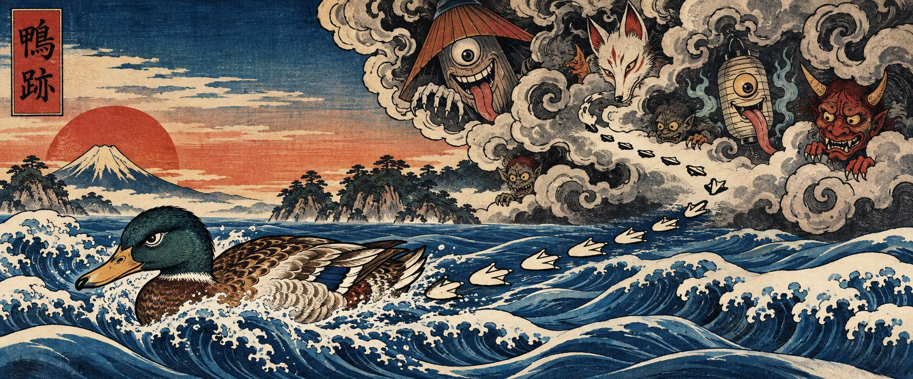
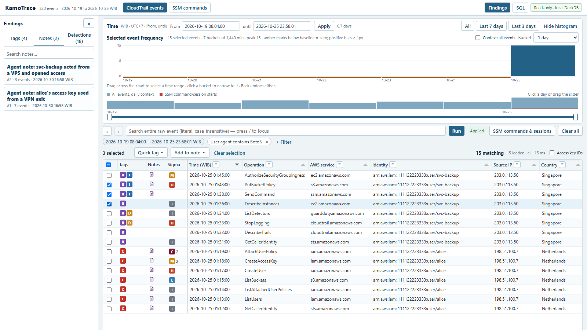

#  KamoTrace

**From AWS login to an AI-assisted investigation in one command.**

KamoTrace collects CloudTrail and SSM activity, adds threat detections and IP
context, and serves a local investigation workspace. Use the browser yourself
or connect an AI assistant through MCP to investigate and record evidence-linked
findings. Original CloudTrail records stay read-only; findings and tags live
separately.

## Get started

You need Python 3.11+, [uv](https://docs.astral.sh/uv/getting-started/installation/)
and a local checkout of this repository. No database server, Docker or Node.js
build is required. These examples use PowerShell; replace the paths and AWS
profile with your own.

### 1. Install and prepare AWS access

Install KamoTrace and generate one read-only collection policy for CloudTrail,
SSM and network inventory. Neither command needs an AWS login:

```powershell
uv tool install C:\path\to\KamoTrace
kamotrace policy --output combined-policy.json
```

Your AWS login needs collection permissions, not just console access. Replace
the policy's bucket and KMS-key placeholders with your current and historical
log destinations, or supply repeatable `--bucket NAME` and `--kms-key ARN`
arguments when generating it. Use `--no-kms` only if none of the required S3
objects use SSE-KMS. Already have the required access? Skip policy generation.

Have an administrator review the policy and grant it to your investigation
role/user through your normal IAM process. KamoTrace **never attaches policies
or changes AWS permissions**. Review bucket-wide reads and wildcard
metadata/CloudWatch access, cross-account bucket/key policies and explicit denies.
See the [collection IAM guide](docs/preparation.md#aws-collection-iam-policy)
for a copyable example, discovery commands and detailed scope guidance.

You or your administrator can optionally validate the reviewed file with AWS
IAM Access Analyzer after logging in:

```powershell
aws sso login --profile investigation
kamotrace policy --validate-file combined-policy.json --profile investigation --region us-east-1
```

The validating login separately needs `access-analyzer:ValidatePolicy`.
Validation checks policy syntax and security recommendations, **not effective
access**. Findings return a nonzero exit status; unresolved placeholders must
be replaced first. Policy files are never overwritten. If you already have
exports, skip AWS access setup and use the offline example below.

### 2. Run auto mode

Log in with your usual AWS tooling using the investigation role, then choose
a new case folder:

```powershell
aws sso login --profile investigation
kamotrace auto C:\cases\example --profile investigation
```

**Auto handles the preparation:** collect CloudTrail and SSM across enabled
regions, import the events, add Suzaku Sigma detections and offline DB-IP Lite
enrichment, collect a current network inventory, then start the browser UI and MCP.
Suzaku and DB-IP Lite are downloaded and verified if needed.

Open **http://127.0.0.1:8765** on the computer running KamoTrace. Leave the command
running while you investigate. Interrupted? **Rerun the same command** to resume;
use a new case folder for a fresh collection.

By default, collection requests the maximum available history: CloudTrail Event
History retains 90 days of management events; SSM command and terminated session
history generally retain 30 days. For a specific window, add
`--start 2026-10-01 --end 2026-10-02` (both UTC dates included). With `--start`,
auto prefers discovered S3 trail locations with readable listings for every requested
Region, allowing empty days and unused Regions; otherwise it uses Event History.
Empty days are reported, not treated as proof of missing logs or complete coverage.
Omit `--end` to collect through now
(the first run's start time, frozen on resume). Neither source guarantees complete coverage.

Already have a CloudTrail JSON export? Skip AWS collection:

```powershell
kamotrace auto C:\cases\offline --source C:\exports\cloudtrail.json
```

See [auto options and recovery](docs/user-guide.md#full-auto-preparation) or
the [manual preparation and collection reference](docs/preparation.md) for more control.

#### Optional GuardDuty alerts

Opt in to retained GuardDuty findings alongside the normal collection:

```powershell
kamotrace auto C:\cases\example-gd --profile investigation --services cloudtrail ssm guardduty
```

Or download findings separately and import them against existing evidence:

```powershell
kamotrace download --dest C:\cases\gd-export --profile investigation --regions all --services guardduty
kamotrace guardduty --database C:\cases\example\case.duckdb --findings C:\cases\gd-export\guardduty.json
```

Existing AWS `GetFindings` JSON (`Findings` array), or a bare findings array, works
offline too. Auto accepts `--guardduty-findings FILE` with existing CloudTrail inputs.
The derived `<database>.guardduty.duckdb` sidecar is picked up by `serve` on restart
(or pass `--guardduty PATH`). Use `--replace` to rebuild a recognised GuardDuty
sidecar; original evidence is never modified. Auto reuses verified unchanged inputs.

The **Detections** tab and MCP `list_detections` / `query.rules` include explicitly
labelled **GuardDuty context (not exact)** leads. Context requires the finding's
account to match `userIdentity.accountId`, region and exact access key, within
`[EventFirstSeen, EventLastSeen)`. It does not establish that GuardDuty detected
that particular CloudTrail event. Missing keys/times, zero-length intervals and
other resource types remain unlinked, not guessed from IPs. All findings and their
raw JSON remain in the source and sidecar; linked finding JSON is also available
in event details and MCP `get_event`, separately from original CloudTrail JSON.

Collection needs `guardduty:ListDetectors`, `guardduty:ListFindings` and
`guardduty:GetFindings` **in addition to** the generated default collection policy
(plus normal STS identity and, for `--regions all`, EC2 region discovery access).
It never enables or changes a detector. Archived findings are included.
`--start` / `--end` select **finding updatedAt**, not the activity's event time;
omit them for all retained findings up to collection start. GuardDuty generally
retains findings for 90 days. No enabled detector is reported separately from an
empty findings list; denied calls fail collection, never masquerade as no findings.
Downloads resume from checkpoints, not live sync; use a new destination to refresh.
`--compress` does not compress `guardduty.json`. Treat exports as sensitive data.

### 3. Connect your AI assistant

Auto serves MCP at **http://127.0.0.1:8765/mcp** alongside the browser. Keep it
running and register the connection with your assistant:

```powershell
# Amp
amp mcp add kamotrace http://127.0.0.1:8765/mcp
# Or Claude Code
claude mcp add --transport http kamotrace http://127.0.0.1:8765/mcp
```

[Install the investigation skill](docs/user-guide.md#agent-skill) to give your
assistant KamoTrace's investigation workflow and evidence-handling rules.
[Other clients and stdio setup](docs/user-guide.md#connect-your-client) are also supported.

### 4. Start an investigation

Try one of these prompts in your connected assistant:

> Investigate critical and high-severity alerts. Follow the related activity,
> tag relevant events and save evidence-linked findings. Separate confirmed
> observations from hypotheses.

> Use the event histogram to identify elevated operation counts. Compare spikes
> with surrounding activity, identify the operations and identities driving them,
> and investigate whether they look suspicious. Save your findings.

> Investigate SSM sessions for suspicious access. Correlate sessions with
> CloudTrail activity and inspect available command output. Record supporting
> evidence and flag missing logs rather than assuming no activity occurred.

Review the assistant's **Findings** and event tags in the browser. Detections
are leads, not proof; session transcripts must already have been logged and are
not displayed in the command viewer. See [SSM logging and collection](docs/preparation.md#download-from-an-existing-aws-login).



[Follow the worked investigation](docs/user-guide.md#end-to-end-example), or
[investigate manually](docs/user-guide.md#cloudtrail-workflow) using search,
filters, value counts and the timeline.

## Keep evidence safe

- **Keep access local.** The server has no authentication. Do not expose it to
  your network. For containers, follow the [Docker guide](docs/user-guide.md#docker).
  For an Amp portal preview, the server also accepts the exact host and origin
  in `PUBLIC_URL` (supplied automatically to services started with `--portal`).
  Keep the portal private and use synthetic data for shared previews; this does
  not add application authentication or change the loopback binding default.
- **Check your AI provider's data policy.** KamoTrace runs locally, but your
  assistant may send evidence to its provider. Review AI findings before relying on them.
- **Preserve and back up the case.** Keep original exports, the evidence database
  and its sidecars private and together. Run one server per annotations file;
  stop it before [backing up](docs/user-guide.md#storage-and-backups).
- **Know the limits.** Missing logs do not prove no activity. IP geography is not
  proof of a person's location. Network inventory is current configuration,
  not historical incident-time evidence.

## Further reading

- [User guide](docs/user-guide.md): browser controls, detections, enrichment, SSM and MCP tools.
- [Data preparation](docs/preparation.md): downloads, permissions, S3 trails, imports and inventory.
- [Troubleshooting](docs/user-guide.md#troubleshooting-and-limitations) and [known limitations](docs/BUGS.md).
- [Development checks](docs/user-guide.md#verification) and [contributor guidance](AGENTS.md).

## Licence and credits

KamoTrace uses the [MIT licence](LICENSE). Suzaku is a separate AGPL-3.0 tool;
it is not bundled. Geolocation data is not bundled either. If you use DB-IP Lite
in reports, credit [IP Geolocation by DB-IP](https://db-ip.com) under
[CC BY 4.0](https://creativecommons.org/licenses/by/4.0/).
See [component licences](docs/user-guide.md#open-source-components).

*Kamo* (鴨) is Japanese for duck. KamoTrace follows the tracks (跡) through your
CloudTrail logs.
